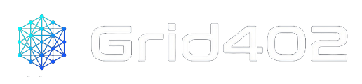
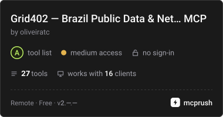

<p align="center">
  
</p>

<p align="center">
  <strong>English</strong> · <a href="README.pt-BR.md">Português (Brasil)</a>
</p>

<h1 align="center">Grid402 — Verifiable Public Data and x402 Payment Layer for AI Agents</h1>

<p align="center">
  <a href="https://github.com/oliveiratc/Grid402/actions"></a>
  <a href="https://www.npmjs.com/package/grid402-mcp"></a>
  <a href="https://pypi.org/project/grid402/"></a>
  
  
</p>

<p align="center">
  <strong>25 live public-data, KYB compliance and network-intelligence APIs</strong> with cryptographic ECDSA <code>secp256k1</code> proofs (<code>_oracle_proof</code>), native <strong>HTTP x402 v2</strong> USDC micropayments (Base, Polygon, Arbitrum, Solana), sub-15ms <strong>Session Passes</strong> (USDC or Pix), and a <strong>27-tool MCP Server</strong>.
</p>

<p align="center">
  <a href="https://grid402.online">Live Portal</a> ·
  <a href="https://grid402.online/catalog">API Catalog</a> ·
  <a href="https://grid402.online/dossie-kyb">KYB Dossier</a> ·
  <a href="https://grid402.online/pass">Session Pass</a> ·
  <a href="https://grid402.online/trust">Trust Center (SLA)</a> ·
  <a href="https://grid402.online/llms.txt">llms.txt</a>
</p>

---

## Try It in 10 Seconds (No Signup, No API Key, No Wallet)

Test any endpoint immediately using the built-in Sandbox header (`X-Payment: demo`, up to 3 requests/day per IP):

```bash
curl -s -H "X-Payment: demo" \
  "https://grid402.online/api/v1/dossier?cnpj=00000000000191"
```

Example signed response (truncated):

```json
{
  "cnpj": "00000000000191",
  "legal_name": "BANCO DO BRASIL SA",
  "verdict": "APPROVED",
  "compliance_score": 100,
  "_meta": {
    "service_id": "dossier",
    "upstream_source": "Receita Federal + CGU CEIS/CNEP + Simples Nacional",
    "oracle_wallet": "0xa592625adbceb8e025ac383f1a3fd8ebb6a63f90"
  },
  "_oracle_proof": {
    "algorithm": "secp256k1-sha256",
    "signer": "0xa592625adbceb8e025ac383f1a3fd8ebb6a63f90",
    "payload_hash": "0x...",
    "signature": "0x..."
  }
}
```

### Add All 27 Tools to Claude Desktop or Cursor (1 Command)

```bash
# Claude Desktop (via Smithery)
npx -y @smithery/cli install grid402-mcp --client claude

# Cursor (via Smithery)
npx -y @smithery/cli install grid402-mcp --client cursor

# Or run directly via stdio
npx -y grid402-mcp
```

---

## Ready-to-Use Recipes (Copy and Paste)

| Use Case | Stack | File |
|---|---|---|
| **CNPJ Compliance 360 + CEP Automation** | n8n (no-code workflow) | [`examples/n8n/grid402_cnpj_compliance_workflow.json`](examples/n8n/grid402_cnpj_compliance_workflow.json) |
| **CNPJ Compliance + Pix Session Pass** | n8n | [`examples/n8n_cnpj_compliance_pix.json`](examples/n8n_cnpj_compliance_pix.json) |
| **Claude Desktop / Cursor MCP (27 tools)** | Node.js / MCP stdio + HTTP | [`mcp/README.md`](mcp/README.md) |
| **LangChain and CrewAI Tools** | Python (`@tool` wrappers) | [`examples/langchain_quickstart.py`](examples/langchain_quickstart.py) |
| **Coinbase CDP AgentKit Auto-Pay** | TypeScript and Python | [`integrations/agentkit/README.md`](integrations/agentkit/README.md) |
| **ElizaOS Autonomous Character Plugin** | TypeScript (`grid402-plugin-elizaos`) | [`integrations/elizaos/README.md`](integrations/elizaos/README.md) |
| **Autonomous x402 Buyer Agent** | Node.js / Python | [`examples/autonomous_agent.mjs`](examples/autonomous_agent.mjs) · [`examples/autonomous_agent.py`](examples/autonomous_agent.py) |

---

## Why Grid402?

* **Pay-Per-Call HTTP x402 v2 (Gasless Multi-Chain via PayAI):** From `0.0050` to `0.0500 USDC` per call with native gasless settlement (`PAYMENT-SIGNATURE`) on **Base**, **Polygon**, **Arbitrum** (EIP-3009) and **Solana** (SVM) — no monthly subscriptions or static API keys required.
* **Sub-15ms Prepaid Session Passes (USDC or Pix):** Avoid per-request signing latency. Top up once via **6 blockchains** (Base, Arbitrum, Polygon, Optimism, Ethereum, Solana) or **Brazilian Pix** (`R$ 12` Starter) and pass `X-Payment: pass_g402_...` with configurable **Spend Controls** (`daily_credit_limit`, `allowed_endpoints`) and `Idempotency-Key` replay safety.
* **Free Teaser Preview on HTTP 402:** Every `402 Payment Required` challenge includes a real truncated `preview` (such as legal name and city for CNPJ, street/district for CEP, or TLS status for SSL) plus `sandbox_test` instructions before any payment is settled.
* **Verifiable Oracle Proofs (`_oracle_proof` + `_meta`):** Every paid response carries upstream provenance metadata and an ECDSA `secp256k1` signature verifiable statelessly via `POST /api/v1/verify`.
* **Zero-DB Architecture:** Ultra-lightweight flat-JSON storage with `flock(LOCK_EX)` concurrency safety and atomic rewrites (`grid402_atomic_write`), delivering 99.5% target SLA with ~40ms average latency.

---

## API Catalog (25 Paid Microservices + Free Utilities)

`1 credit = 0.0050 USDC` (`5,000 raw units` on Base Mainnet).

| Service | Endpoint | Price (USDC / Credits) | Description |
|---|---|---|---|
| **Operational Status** | `GET /status` | Free | Live health, latencies, 30-day uptime and 25 active services |
| **KYB 360 Dossier + AI Verdict** | `GET /api/v1/dossier?cnpj=...` | `0.0500` (10 cr) | RFB CNPJ + Simples/MEI + CGU CEIS/CNEP + deterministic AI verdict (`APPROVED` / `FLAGGED` / `REJECTED`) |
| **Compliance Score 360** | `GET /api/v1/compliance?cnpj=...` | `0.0300` (6 cr) | 0–100 corporate risk score cross-checking Federal Revenue and CGU |
| **KYB Global Audit** | `GET /api/v1/kyb-audit?cnpj=...` | `0.0250` (5 cr) | Corporate audit combining Brazil CNPJ + OFAC/UN Sanctions + GLEIF LEI |
| **OFAC / UN Sanctions and AML** | `GET /api/v1/ofac?target=...` | `0.0200` (4 cr) | US Treasury OFAC SDN, UN Consolidated Sanctions and Base Web3 AML screening |
| **Domain Audit Bundle** | `GET /api/v1/domain-audit?domain=...` | `0.0150` (3 cr) | Consolidated DNS + SSL/TLS + BGP/ASN security audit in one call |
| **Market Snapshot** | `GET /api/v1/market-snapshot` | `0.0150` (3 cr) | Macro bundle: Forex + Crypto + Selic/CDI/IPCA + ANBIMA calendar |
| **Brazil CNPJ Lookup** | `GET /api/v1/cnpj?cnpj=...` | `0.0100` (2 cr) | Legal name, registration status, CNAE and official Receita Federal data |
| **Simples Nacional and MEI** | `GET /api/v1/simples?cnpj=...` | `0.0100` (2 cr) | Tax regime classification (Simples Nacional and SIMEI) |
| **Brazil Sanctions (CEIS/CNEP)** | `GET /api/v1/sanctions?cnpj=...` | `0.0100` (2 cr) | Administrative penalties and debarment checks via CGU |
| **Global LEI Identity** | `GET /api/v1/lei?lei=...` | `0.0100` (2 cr) | ISO 17442 global legal entity registry via GLEIF (200+ jurisdictions) |
| **Commercial Forex** | `GET /api/v1/forex` | `0.0050` (1 cr) | Live USD, EUR and GBP rates to BRL |
| **Global Markets and ECB FX** | `GET /api/v1/global-markets` | `0.0050` (1 cr) | US/EU/UK/BR exchange status and 30+ ECB FX rates |
| **Crypto Spot Prices** | `GET /api/v1/crypto` | `0.0050` (1 cr) | Live spot prices and 24h change for BTC, ETH, SOL, USDC and BASE |
| **BCB / IBGE Macro Indicators** | `GET /api/v1/indicators` | `0.0050` (1 cr) | Official Selic, CDI and 12-month IPCA rates |
| **National Holidays (BR)** | `GET /api/v1/holidays?year=...` | `0.0050` (1 cr) | National and ANBIMA/Febraban banking holiday calendar |
| **ANBIMA Business Days** | `GET /api/v1/workdays` | `0.0050` (1 cr) | Banking workday counting and D+N maturity projection |
| **Brazil Postal Code (CEP)** | `GET /api/v1/cep?code=...` | `0.0050` (1 cr) | Street, neighborhood, city, state and official IBGE municipality code |
| **DNS Resolution** | `GET /api/v1/dns?domain=...` | `0.0050` (1 cr) | A, AAAA, MX, TXT, NS and CNAME records with query latency |
| **SSL/TLS Inspector** | `GET /api/v1/ssl?host=...` | `0.0050` (1 cr) | Issuer, expiration, remaining days and cipher suite |
| **ASN and BGP Intelligence** | `GET /api/v1/asn?ip=...` | `0.0050` (1 cr) | ASN number, BGP prefix, owner organization and country |
| **Web-to-Markdown Extractor** | `GET /api/v1/extract?url=...` | `0.0050` (1 cr) | SSRF-hardened HTML-to-Markdown extraction for LLMs and RAG |
| **B2B Email Verification** | `GET /api/v1/email-verify?email=...` | `0.0050` (1 cr) | Zero-PII RFC, MX, SPF, DMARC, disposable domain check and 0–100 score |
| **SHA-256 Notarization** | `GET /api/v1/notarize?content=...` | `0.0050` (1 cr) | Cryptographic timestamp and ECDSA proof of existence |
| **Prepaid Session Pass** | `GET /api/v1/pass` | `2 / 5 / 20 USDC` | Issue sub-15ms prepaid pass (400 / 1,200 / 6,000 credits) |
| **Pass Balance and Statement** | `GET /api/v1/pass/balance` | Free | Check remaining credits, Spend Controls and CSV/JSON statement |
| **Oracle Proof Verifier** | `POST /api/v1/verify` | Free | Stateless mathematical verification of `_oracle_proof` signatures |

---

## Payment Modes

| Mode | Header / Flow | Best For | Latency |
|---|---|---|---|
| **Sandbox (Free)** | `X-Payment: demo` (3 req/day per IP) | Testing, CI/CD, trying endpoints | `< 40ms` |
| **Session Pass (Prepaid)** | `X-Payment: pass_g402_<id>_<hmac>` | Production apps, n8n, MCP, high-frequency agents | **`< 15ms`** |
| **x402 v2 Gasless** | `PAYMENT-SIGNATURE` (Base, Polygon, Arbitrum, Solana) | Autonomous Web3 agents with wallets | ~1–2s |
| **On-Chain TxHash** | `X-Payment: 0x...` or `arbitrum:0x...` / `polygon:0x...` / `solana:<sig>` | Direct wallet transfers | ~1–3s |

### Session Pass Packages (`https://grid402.online/pass`)
* **Starter:** `2.00 USDC` or `R$ 12` (Pix) -> **400 credits** (180 days validity)
* **Pro:** `5.00 USDC` or `R$ 29` (Pix) -> **1,200 credits** (1,000 base + 20% bonus, 180 days validity)
* **Fleet:** `20.00 USDC` or `R$ 115` (Pix) -> **6,000 credits** (4,000 base + 50% bonus, 365 days validity)

Official recipient wallets:
* **EVM (Base, Arbitrum, Polygon, Optimism, Ethereum):** `0xa592625adbceb8e025ac383f1a3fd8ebb6a63f90`
* **Solana Mainnet (SPL USDC):** `CSgJyQTwehb3vF2vbsDMdUuBPdcuvx1vdEEhGvVCCF8C`

---

## Framework Integrations

### 1. MCP Server (`grid402-mcp` + `smithery.yaml`)
Configure in Claude Desktop or Cursor using a Session Pass (no private key required):

```json
{
  "mcpServers": {
    "grid402": {
      "command": "npx",
      "args": ["-y", "grid402-mcp"],
      "env": {
        "GRID402_SESSION_PASS": "pass_g402_your_token_here"
      }
    }
  }
}
```

Also available via [PayAPI Market](https://payapi.market/api/grid402-brazil-public-data-network-oracle) (`https://payapi.market/mcp`) and public Streamable HTTP MCP (`https://grid402.online/mcp`).

### 2. Coinbase CDP AgentKit (M2M Auto-Settlement)

```typescript
import { AgentKit, CdpWalletProvider } from "@coinbase/agentkit";
import { Grid402ActionProvider } from "./integrations/agentkit/grid402_action_provider";

const walletProvider = await CdpWalletProvider.configureWithWallet();
const agentKit = await AgentKit.from({
  walletProvider,
  actionProviders: [new Grid402ActionProvider()]
});
```

Full TypeScript and Python guides: [`integrations/agentkit/README.md`](integrations/agentkit/README.md).

### 3. ElizaOS Plugin (`grid402-plugin-elizaos`)

```typescript
import { grid402Plugin } from "grid402-plugin-elizaos";

export const character = {
  name: "CryptoComplianceAgent",
  plugins: [grid402Plugin],
  settings: {
    secrets: {
      GRID402_PASS_TOKEN: "pass_g402_live..."
    }
  }
};
```

See [`integrations/elizaos/README.md`](integrations/elizaos/README.md).

### 4. Python SDK / LangChain and CrewAI

```bash
pip install grid402
```

```python
from examples.langchain_quickstart import Grid402Client

client = Grid402Client(use_sandbox=True)
forex = client.get_forex()
print("USD/BRL:", forex["rates"]["USD"]["bid"])
```

See [`examples/langchain_quickstart.py`](examples/langchain_quickstart.py).

---

## Verified Directories and Ecosystem Badges

<details>
<summary>Click to view all verified listings (x402scan, Glama, PayAPI Market, PayCensus, SealKeeper, RapidAPI, mcptry, Wellknown)</summary>

<br>

[](https://payapi.market/api/grid402-brazil-public-data-network-oracle)
[-00F0FF)](https://www.x402scan.com/server/00294038-51ff-4073-ab29-c59fca221a50)
[-0052FF)](https://glama.ai/mcp/connectors/io.github.oliveiratc/grid402)
[](https://paycensus.com/s/0xa592625adbceb8e025ac383f1a3fd8ebb6a63f90.html)
[-10B981)](https://sealkeeper.run/agents/grid402.online/grid402-online)
[](https://rapidapi.com/oliveiratc/api/grid402-open-data-kyb-ai-utilities)
[](https://mcptry.com/servers/io.github.oliveiratc/grid402)
[](https://wellknown.network/agents/grid402-mcp)
[](MANUAL_DE_MARCA.md)

[](https://mcprush.com/to/grid402-brazil-public-data-network-oracle-mcp?ref=badge)

</details>

---

## Repository Structure and Local Tests

```text
├── smithery.yaml            # Smithery.ai 1-click MCP manifest
├── mcp/                     # Official MCP server package (grid402-mcp, 27 tools)
├── sdk/                     # Official JavaScript/TypeScript SDK (npm: grid402)
├── python/                  # Official Python SDK (PyPI: grid402)
├── integrations/            # Coinbase CDP AgentKit and ElizaOS plugins
├── examples/                # Ready-to-run n8n, LangChain, Node and Python recipes
├── public_html/             # Production gateway (PHP 8.1+ Zero-DB, x402, OpenAPI, llms.txt)
├── docs/                    # Architecture and Base Grants / CDP dossier
└── tests/                   # Automated maturity, concurrency, E2E and integration suites
```

Run the local test suites (PHP 8.1+ and Node.js):

```powershell
php scripts/verify_storage_integrity.php
php tests/test_maturity_and_m2m_controls.php
php tests/test_concurrency_and_load.php
php tests/test_session_pass_statement.php
php tests/test_agentkit_integration.php
node mcp/test_mcp.mjs
```

---

## Non-Custodial Security and M2M Key Hygiene

* **Zero Key Custody:** The Grid402 gateway never requests or stores client private keys or seed phrases.
* **Isolated Agent Budgets:** When using `GRID402_PRIVATE_KEY` in `grid402-mcp` or AgentKit, always use a dedicated operational wallet funded strictly with your automation budget.
* **Spend Controls via Session Pass:** To eliminate private key exposure in agent runtimes, issue a `pass_g402_...` token with `daily_credit_limit` and `allowed_endpoints`, and monitor usage via `GET /api/v1/pass/balance`.

---

## Dual Licensing

| Layer / Directory | License | Scope |
|---|---|---|
| **SDKs, MCP Server and Integrations** (`python/`, `mcp/`, `sdk/`, `integrations/`, `examples/`) | **MIT License** | Free commercial and open-source use in AI agents, forks and SaaS products |
| **Gateway and Server Platform** (`public_html/`) | **Proprietary (All Rights Reserved)** | HTTP x402 gateway, ECDSA oracle signer, Session Pass engine, web portal and admin panel |
| **Underlying Public Data** | **Public Domain / CC0 / LAI** | Official public registries and open IETF network protocols |

Institutional dossier: [`docs/BASE_GRANTS_AND_CDP_DOSSIER.md`](docs/BASE_GRANTS_AND_CDP_DOSSIER.md) · Terms: [`LICENSE`](LICENSE) · AI Discovery: [`public_html/llms.txt`](public_html/llms.txt).

---

## Community and Contributions

* **Like what we are building?** Give this repository a **Star** so more AI and automation builders can find it.
* **Need a new public data endpoint?** Open a thread in [GitHub Discussions](https://github.com/oliveiratc/Grid402/discussions) with the upstream source and use case.
* **Built an n8n, Make, LangGraph or CrewAI template?** PRs adding new recipes to `examples/` (MIT licensed) are very welcome.

© 2026 **Grid402 Network Intelligence**.
