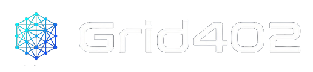
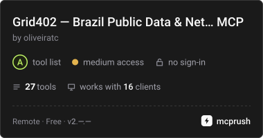

<p align="center">
  
</p>

<p align="center">
  <a href="README.md">English</a> · <strong>Português (Brasil)</strong>
</p>

<h1 align="center">Grid402 — Camada de Dados Públicos Verificáveis e Pagamentos x402 para Agentes de IA</h1>

<p align="center">
  <a href="https://github.com/oliveiratc/Grid402/actions"></a>
  <a href="https://www.npmjs.com/package/grid402-mcp"></a>
  <a href="https://pypi.org/project/grid402/"></a>
  
  
</p>

<p align="center">
  <a href="https://glama.ai/mcp/servers/oliveiratc/Grid402"></a>
  <a href="https://glama.ai/mcp/connectors/io.github.oliveiratc/grid402"></a>
</p>

<p align="center">
  <strong>25 APIs em produção de dados públicos, compliance KYB e inteligência de rede</strong> com prova criptográfica ECDSA <code>secp256k1</code> (<code>_oracle_proof</code>), micropagamentos nativos <strong>HTTP x402 v2</strong> em USDC (Base, Polygon, Arbitrum, Solana), <strong>Session Passes</strong> sub-15ms (USDC ou Pix) e <strong>Servidor MCP com 27 ferramentas</strong>.
</p>

<p align="center">
  <a href="https://grid402.online">Portal ao Vivo</a> ·
  <a href="https://grid402.online/catalog">Catálogo de APIs</a> ·
  <a href="https://grid402.online/dossie-kyb">Dossiê KYB</a> ·
  <a href="https://grid402.online/pass">Session Pass</a> ·
  <a href="https://grid402.online/trust">Trust Center (SLA)</a> ·
  <a href="https://grid402.online/llms.txt">llms.txt</a>
</p>

---

## Teste em 10 Segundos (Sem Cadastro, Sem API Key, Sem Wallet)

Experimente qualquer endpoint agora usando o modo Sandbox gratuito (`X-Payment: demo`, até 3 consultas/dia por IP):

```bash
curl -s -H "X-Payment: demo" \
  "https://grid402.online/api/v1/dossier?cnpj=00000000000191"
```

Exemplo de resposta assinada (resumida):

```json
{
  "cnpj": "00000000000191",
  "legal_name": "BANCO DO BRASIL SA",
  "verdict": "APPROVED",
  "compliance_score": 100,
  "_meta": {
    "service_id": "dossier",
    "upstream_source": "Receita Federal + CGU CEIS/CNEP + Simples Nacional",
    "oracle_wallet": "0xa592625adbceb8e025ac383f1a3fd8ebb6a63f90"
  },
  "_oracle_proof": {
    "algorithm": "secp256k1-sha256",
    "signer": "0xa592625adbceb8e025ac383f1a3fd8ebb6a63f90",
    "payload_hash": "0x...",
    "signature": "0x..."
  }
}
```

### Adicione as 27 Ferramentas no Claude Desktop ou Cursor (1 Comando)

```bash
# Claude Desktop (via Smithery)
npx -y @smithery/cli install grid402-mcp --client claude

# Cursor (via Smithery)
npx -y @smithery/cli install grid402-mcp --client cursor

# Ou execute direto via stdio
npx -y grid402-mcp
```

---

## Receitas Prontas (Copiar e Rodar)

| Caso de Uso | Stack | Arquivo |
|---|---|---|
| **Compliance 360 de CNPJ + CEP Automático** | n8n (workflow pronto) | [`examples/n8n/grid402_cnpj_compliance_workflow.json`](examples/n8n/grid402_cnpj_compliance_workflow.json) |
| **Compliance CNPJ + Session Pass via Pix** | n8n | [`examples/n8n_cnpj_compliance_pix.json`](examples/n8n_cnpj_compliance_pix.json) |
| **MCP para Claude Desktop e Cursor (27 tools)** | Node.js / MCP stdio + HTTP | [`mcp/README.md`](mcp/README.md) |
| **Ferramentas para LangChain e CrewAI** | Python (wrappers `@tool`) | [`examples/langchain_quickstart.py`](examples/langchain_quickstart.py) |
| **Coinbase CDP AgentKit (Auto-Settlement)** | TypeScript e Python | [`integrations/agentkit/README.md`](integrations/agentkit/README.md) |
| **Plugin Oficial para ElizaOS** | TypeScript (`grid402-plugin-elizaos`) | [`integrations/elizaos/README.md`](integrations/elizaos/README.md) |
| **Agente Comprador Autônomo x402** | Node.js / Python | [`examples/autonomous_agent.mjs`](examples/autonomous_agent.mjs) · [`examples/autonomous_agent.py`](examples/autonomous_agent.py) |

---

## Por que usar o Grid402?

* **Pagamento por Chamada via HTTP x402 v2 (Gasless Multi-Chain via PayAI):** De `0.0050` a `0.0500 USDC` por consulta com liquidação gasless (`PAYMENT-SIGNATURE`) em **Base**, **Polygon**, **Arbitrum** (EIP-3009) e **Solana** (SVM), sem mensalidade fixa.
* **Session Passes Pré-Pagos Sub-15ms (Pix ou USDC):** Evite a latência de assinar uma transação a cada requisição. Recarregue uma vez via **Pix (`R$ 12` Starter)** ou **6 blockchains** (Base, Arbitrum, Polygon, Optimism, Ethereum, Solana) e use `X-Payment: pass_g402_...` com **Spend Controls** (`daily_credit_limit`, `allowed_endpoints`) e proteção `Idempotency-Key`.
* **Amostras Gratuitas no HTTP 402 (Teaser Data):** Todo desafio `402 Payment Required` já retorna uma prévia real dos dados (razão social e município no CNPJ, logradouro no CEP, status TLS no SSL) + instruções de teste gratuito antes da cobrança.
* **Provas Criptográficas de Oráculo (`_oracle_proof` + `_meta`):** Toda resposta paga inclui metadados de proveniência e assinatura ECDSA `secp256k1` verificável via `POST /api/v1/verify`.
* **Arquitetura Zero-DB:** Armazenamento ultraleve em arquivos JSON com travamento concorrente `flock(LOCK_EX)` e escrita atômica (`grid402_atomic_write`), mantendo SLA alvo de 99,5% e latência média ~40ms.

---

## Catálogo de APIs (25 Micro-Serviços Pagos + Utilitários Gratuitos)

`1 crédito = 0.0050 USDC` (`5.000 raw units` na Base Mainnet).

| Serviço | Rota da API | Custo (USDC / Créditos) | Descrição Técnica |
|---|---|---|---|
| **Resumo Operacional** | `GET /status` | Gratuito | Saúde geral, latências médias, uptime 30d e 25 serviços operantes |
| **Dossiê 360º KYB + Veredito IA** | `GET /api/v1/dossier?cnpj=...` | `0.0500` (10 cr) | RFB CNPJ + Simples/MEI + CGU CEIS/CNEP + veredito determinístico (`APPROVED` / `FLAGGED` / `REJECTED`) |
| **Compliance Score 360** | `GET /api/v1/compliance?cnpj=...` | `0.0300` (6 cr) | Score de risco corporativo de 0 a 100 cruzando Receita Federal e CGU |
| **Dossiê KYB Audit Global** | `GET /api/v1/kyb-audit?cnpj=...` | `0.0250` (5 cr) | Auditoria corporativa: Receita Federal CNPJ + Sanções OFAC/ONU + GLEIF LEI |
| **Sanções OFAC e AML Web3** | `GET /api/v1/ofac?target=...` | `0.0200` (4 cr) | Triagem OFAC SDN, ONU e risco AML Web3 na Base Mainnet |
| **Auditoria de Domínio** | `GET /api/v1/domain-audit?domain=...` | `0.0150` (3 cr) | Bundle consolidado DNS + TLS/SSL + BGP/ASN em chamada única |
| **Market Snapshot** | `GET /api/v1/market-snapshot` | `0.0150` (3 cr) | Panorama macro: Câmbio + Cripto + Selic/CDI/IPCA + ANBIMA |
| **Consulta CNPJ** | `GET /api/v1/cnpj?cnpj=...` | `0.0100` (2 cr) | Razão social, situação cadastral, CNAE e dados da Receita Federal |
| **Simples Nacional e MEI** | `GET /api/v1/simples?cnpj=...` | `0.0100` (2 cr) | Enquadramento tributário Simples Nacional e SIMEI |
| **Sanções CEIS/CNEP** | `GET /api/v1/sanctions?cnpj=...` | `0.0100` (2 cr) | Checagem de inidoneidade e punições administrativas na CGU |
| **Identidade Global LEI** | `GET /api/v1/lei?lei=...` | `0.0100` (2 cr) | Registro corporativo global ISO 17442 via GLEIF (200+ jurisdições) |
| **Câmbio Comercial** | `GET /api/v1/forex` | `0.0050` (1 cr) | Cotações em tempo real de USD, EUR e GBP para BRL |
| **Mercados Globais e BCE** | `GET /api/v1/global-markets` | `0.0050` (1 cr) | Calendário US/EU/UK/BR e 30+ taxas de câmbio do Banco Central Europeu |
| **Preços Cripto** | `GET /api/v1/crypto` | `0.0050` (1 cr) | Cotações spot e variação 24h de BTC, ETH, SOL, USDC e BASE |
| **Indicadores BCB/IBGE** | `GET /api/v1/indicators` | `0.0050` (1 cr) | Taxas oficiais Selic, CDI e IPCA acumulado 12m |
| **Feriados Nacionais** | `GET /api/v1/holidays?year=...` | `0.0050` (1 cr) | Calendário nacional e bancário ANBIMA/Febraban |
| **Dias Úteis ANBIMA** | `GET /api/v1/workdays` | `0.0050` (1 cr) | Contagem e projeção de vencimentos D+N bancários |
| **Consulta Postal CEP** | `GET /api/v1/cep?code=...` | `0.0050` (1 cr) | Logradouro, bairro, cidade, UF e código IBGE oficial |
| **Resolução DNS** | `GET /api/v1/dns?domain=...` | `0.0050` (1 cr) | Registros A, AAAA, MX, TXT, NS e CNAME com latência |
| **Inspetor SSL/TLS** | `GET /api/v1/ssl?host=...` | `0.0050` (1 cr) | Emissor, validade, dias restantes e cipher suite |
| **Inteligência ASN/BGP** | `GET /api/v1/asn?ip=...` | `0.0050` (1 cr) | Número ASN, prefixo BGP, organização detentora e país |
| **Extrator Web para Markdown** | `GET /api/v1/extract?url=...` | `0.0050` (1 cr) | Extração anti-SSRF de páginas HTML para Markdown limpo (LLMs e RAG) |
| **Auditoria de E-mail B2B** | `GET /api/v1/email-verify?email=...` | `0.0050` (1 cr) | Validação Zero-PII (RFC, MX, SPF, DMARC, domínios descartáveis e score 0–100) |
| **Notarização SHA-256** | `GET /api/v1/notarize?content=...` | `0.0050` (1 cr) | Carimbo do tempo criptográfico e prova de existência ECDSA |
| **Session Pass x402** | `GET /api/v1/pass` | `2 / 5 / 20 USDC` | Emissão de passe pré-pago sub-15ms (400 / 1.200 / 6.000 créditos) |
| **Saldo e Extrato do Passe** | `GET /api/v1/pass/balance` | Gratuito | Consulta de créditos restantes, Spend Controls e extrato CSV/JSON |
| **Verificador de Prova** | `POST /api/v1/verify` | Gratuito | Verificação matemática stateless da assinatura `_oracle_proof` |

---

## Formas de Pagamento

| Modo | Cabeçalho / Fluxo | Ideal Para | Latência |
|---|---|---|---|
| **Sandbox (Gratuito)** | `X-Payment: demo` (3 req/dia por IP) | Testes rápidos, CI/CD e homologação | `< 40ms` |
| **Session Pass (Pré-Pago)** | `X-Payment: pass_g402_<id>_<hmac>` | Produção, n8n, MCP e alta frequência | **`< 15ms`** |
| **x402 v2 Gasless** | `PAYMENT-SIGNATURE` (Base, Polygon, Arbitrum, Solana) | Agentes Web3 autônomos com carteira | ~1–2s |
| **TxHash On-Chain** | `X-Payment: 0x...` ou `arbitrum:0x...` / `polygon:0x...` / `solana:<sig>` | Transferência direta on-chain | ~1–3s |

### Pacotes de Session Pass (`https://grid402.online/pass`)
* **Starter:** `2,00 USDC` ou `R$ 12` (Pix) -> **400 créditos** (validade 180 dias)
* **Pro:** `5,00 USDC` ou `R$ 29` (Pix) -> **1.200 créditos** (1.000 base + 20% bônus, validade 180 dias)
* **Fleet:** `20,00 USDC` ou `R$ 115` (Pix) -> **6.000 créditos** (4.000 base + 50% bônus, validade 365 dias)

Carteiras recebedoras oficiais:
* **EVM (Base, Arbitrum, Polygon, Optimism, Ethereum):** `0xa592625adbceb8e025ac383f1a3fd8ebb6a63f90`
* **Solana Mainnet (SPL USDC):** `CSgJyQTwehb3vF2vbsDMdUuBPdcuvx1vdEEhGvVCCF8C`

---

## Integrações com Frameworks de IA

### 1. Servidor MCP (`grid402-mcp` + `smithery.yaml`)
Configure no Claude Desktop ou Cursor usando Session Pass (sem expor chave privada):

```json
{
  "mcpServers": {
    "grid402": {
      "command": "npx",
      "args": ["-y", "grid402-mcp"],
      "env": {
        "GRID402_SESSION_PASS": "pass_g402_seu_token_aqui"
      }
    }
  }
}
```

Também disponível no [PayAPI Market](https://payapi.market/api/grid402-brazil-public-data-network-oracle) (`https://payapi.market/mcp`) e via MCP HTTP Streamable público (`https://grid402.online/mcp`).

### 2. Coinbase CDP AgentKit (Liquidação Automática M2M)

```typescript
import { AgentKit, CdpWalletProvider } from "@coinbase/agentkit";
import { Grid402ActionProvider } from "./integrations/agentkit/grid402_action_provider";

const walletProvider = await CdpWalletProvider.configureWithWallet();
const agentKit = await AgentKit.from({
  walletProvider,
  actionProviders: [new Grid402ActionProvider()]
});
```

Guias completos em TypeScript e Python: [`integrations/agentkit/README.md`](integrations/agentkit/README.md).

### 3. Plugin Oficial para ElizaOS (`grid402-plugin-elizaos`)

```typescript
import { grid402Plugin } from "grid402-plugin-elizaos";

export const character = {
  name: "CryptoComplianceAgent",
  plugins: [grid402Plugin],
  settings: {
    secrets: {
      GRID402_PASS_TOKEN: "pass_g402_live..."
    }
  }
};
```

Veja [`integrations/elizaos/README.md`](integrations/elizaos/README.md).

### 4. SDK Python / LangChain e CrewAI

```bash
pip install grid402
```

```python
from examples.langchain_quickstart import Grid402Client

client = Grid402Client(use_sandbox=True)
forex = client.get_forex()
print("USD/BRL:", forex["rates"]["USD"]["bid"])
```

Veja [`examples/langchain_quickstart.py`](examples/langchain_quickstart.py).

---

## Diretórios Verificados e Badges do Ecossistema

<details>
<summary>Clique para ver todas as listagens verificadas (x402scan, Glama, PayAPI Market, PayCensus, SealKeeper, RapidAPI, mcptry, Wellknown)</summary>

<br>

[](https://payapi.market/api/grid402-brazil-public-data-network-oracle)
[-00F0FF)](https://www.x402scan.com/server/00294038-51ff-4073-ab29-c59fca221a50)
[-0052FF)](https://glama.ai/mcp/connectors/io.github.oliveiratc/grid402)
[](https://paycensus.com/s/0xa592625adbceb8e025ac383f1a3fd8ebb6a63f90.html)
[-10B981)](https://sealkeeper.run/agents/grid402.online/grid402-online)
[](https://rapidapi.com/oliveiratc/api/grid402-open-data-kyb-ai-utilities)
[](https://mcptry.com/servers/io.github.oliveiratc/grid402)
[](https://wellknown.network/agents/grid402-mcp)
[](MANUAL_DE_MARCA.md)

[](https://mcprush.com/to/grid402-brazil-public-data-network-oracle-mcp?ref=badge)

</details>

---

## Estrutura do Repositório e Testes Locais

```text
├── smithery.yaml            # Manifesto Smithery.ai para instalação MCP em 1 clique
├── mcp/                     # Pacote oficial do servidor MCP (grid402-mcp, 27 tools)
├── sdk/                     # SDK oficial JavaScript/TypeScript (npm: grid402)
├── python/                  # SDK oficial Python (PyPI: grid402)
├── integrations/            # Provedor Coinbase CDP AgentKit e plugin ElizaOS
├── examples/                # Receitas prontas para n8n, LangChain, Node e Python
├── public_html/             # Gateway de produção (PHP 8.1+ Zero-DB, x402, OpenAPI, llms.txt)
├── docs/                    # Arquitetura e Dossiê Base Grants / Coinbase CDP
└── tests/                   # Suítes automatizadas de maturidade, concorrência, E2E e integração
```

Execute os testes locais (PHP 8.1+ e Node.js):

```powershell
php scripts/verify_storage_integrity.php
php tests/test_maturity_and_m2m_controls.php
php tests/test_concurrency_and_load.php
php tests/test_session_pass_statement.php
php tests/test_agentkit_integration.php
node mcp/test_mcp.mjs
```

---

## Segurança Não-Custodial e Gestão de Chaves M2M

* **Zero Custódia de Chaves:** O gateway servidor nunca solicita nem armazena chaves privadas ou seed phrases de clientes.
* **Carteiras Isoladas de Orçamento:** Ao usar `GRID402_PRIVATE_KEY` no `grid402-mcp` ou Coinbase AgentKit, utilize uma carteira operacional dedicada com saldo limitado ao orçamento de automação.
* **Spend Controls com Session Pass:** Para eliminar exposição de chave privada no runtime do agente, emita um `pass_g402_...` com `daily_credit_limit` e `allowed_endpoints` e acompanhe o consumo via `GET /api/v1/pass/balance`.

---

## Licenciamento (Dual-License)

| Camada / Diretório | Licença Aplicável | Escopo |
|---|---|---|
| **SDKs, MCP Server e Integrações** (`python/`, `mcp/`, `sdk/`, `integrations/`, `examples/`) | **MIT License** | Uso livre, comercial ou aberto, em agentes autônomos, forks e produtos SaaS |
| **Gateway e Plataforma Servidora** (`public_html/`) | **Proprietária (All Rights Reserved)** | Motor HTTP x402, assinador ECDSA do Oráculo, Session Pass, portal web e painel admin (`Lei nº 9.609/1998` e `Lei nº 9.610/1998`) |
| **Dados Consultados nas APIs** | **Domínio Público / CC0 / LAI** | Registros governamentais abertos e protocolos IETF |

Dossiê institucional: [`docs/BASE_GRANTS_AND_CDP_DOSSIER.md`](docs/BASE_GRANTS_AND_CDP_DOSSIER.md) · Termos: [`LICENSE`](LICENSE) · Descoberta IA: [`public_html/llms.txt`](public_html/llms.txt).

---

## Comunidade e Contribuições

* **Curtiu o projeto?** Deixe uma **Star** no repositório para ajudar outros devs e construtores de agentes a encontrarem o Grid402.
* **Precisa de um novo endpoint de dados públicos?** Abra um tópico em [GitHub Discussions](https://github.com/oliveiratc/Grid402/discussions) sugerindo a fonte e o caso de uso.
* **Criou um template para n8n, Make, LangGraph ou CrewAI?** PRs adicionando receitas em `examples/` (licença MIT) são muito bem-vindos.

© 2026 **Grid402 Network Intelligence**.
