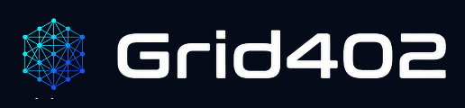

# Manual de Identidade Visual · Grid402



## 1. Conceito e Essência da Marca
O **Grid402** é o hub de micro-serviços M2M, dados públicos e utilitários de rede para agentes de IA. A marca transmite velocidade, precisão matemática e descentralização autônoma. O símbolo principal evoca uma malha tridimensional de nós interconectados — representando a infraestrutura de dados e a liquidação instantânea via protocolo x402 na Base.

---

## 2. Paleta de Cores Oficial
A identidade cromática utiliza um fundo escuro profundo de alta tecnologia combinado com ciano e azul elétrico para simular feixes de dados e nós de rede em milissegundos.

* **Obsidian Grid (Fundo Principal):** `#060B19` — O azul escuro profundo que serve de base para toda a interface e elementos gráficos.
* **Base Blue (Cor Primária):** `#0052FF` — Representa a solidez da rede Base e a infraestrutura corporativa/desenvolvedor.
* **Autonomous Cyan (Cor Secundária):** `#00F0FF` — O ciano neon luminoso usado para destacar os nós de conexões rápidas e chamadas ativas.
* **Signal White (Acento / Tipografia):** `#F8FAFC` — Branco puro de alta legibilidade para títulos e dados críticos.

### Variáveis CSS Oficiais (`:root`)
```css
:root {
    --bg: #060B19;               /* Obsidian Grid - Fundo Principal */
    --surface: #0B132B;          /* Superfície de cards e painéis */
    --surface-hover: #111C38;    /* Hover de cards interativos */
    --border: #1E2C4F;           /* Bordas sutis */
    --border-glow: rgba(0, 240, 255, 0.25); /* Brilho de borda em ciano */
    --primary: #0052FF;          /* Base Blue - Ações principais */
    --primary-glow: rgba(0, 82, 255, 0.25);
    --secondary: #00F0FF;        /* Autonomous Cyan - Destaques e nós */
    --accent: #00F0FF;           /* Autonomous Cyan */
    --accent-glow: rgba(0, 240, 255, 0.2);
    --text-main: #F8FAFC;        /* Signal White - Títulos e textos principais */
    --text-muted: #94A3B8;       /* Texto secundário e legendas */
    --font-heading: 'Space Grotesk', system-ui, sans-serif;
    --font-sans: 'Inter', system-ui, sans-serif;
    --font-mono: 'JetBrains Mono', monospace;
}
```

---

## 3. Tipografia
A hierarquia tipográfica foi desenhada para unir o rigor de engenharia de protocolos com a clareza de interfaces modernas para desenvolvedores:

* **Títulos e Logotipo:** **Space Grotesk** (Peso 700 / Bold) — Geométrica, moderna e com forte apelo futurista.
* **Corpo de Texto:** **Inter** (Peso 400 / Regular) — Altamente legível em telas e documentações extensas.
* **Dados Técnicos, Rotas de API e Códigos:** **JetBrains Mono** (Peso 500 / Medium) — Monoespaçada ideal para trechos JSON, logs e hashes criptográficos.

---

## 4. Diretrizes de Aplicação do Logotipo
* **Uso Principal:** O logo deve ser aplicado preferencialmente sobre fundos escuros (`#060B19`) para garantir o contraste adequado do brilho em ciano e azul dos nós geométricos.
* **Área de Respeito:** Mantenha uma margem de respiro ao redor do símbolo equivalente à largura da letra "G" do logotipo.
* **O que evitar:** Nunca aplique o logo sobre fundos claros lavados, não altere as proporções do símbolo geométrico e evite adicionar sombras ou efeitos tridimensionais externos que poluam a leitura.

---

## 5. Tom de Voz e Comunicação
* **Personalidade:** Um arquiteto de sistemas autônomos que constrói o futuro M2M com precisão técnica e sem burocracia.
* **Diretrizes de Linguagem:** 
  * Seja direto, técnico e focado em eficiência (sem enrolação ou jargões comerciais vazios).
  * Enfatize a ausência de mensalidades e o modelo pay-per-call (R$ 0,01 por consulta via x402).
  * Sempre direcione os desenvolvedores para testes instantâneos no playground e documentação em `grid402.online`.

