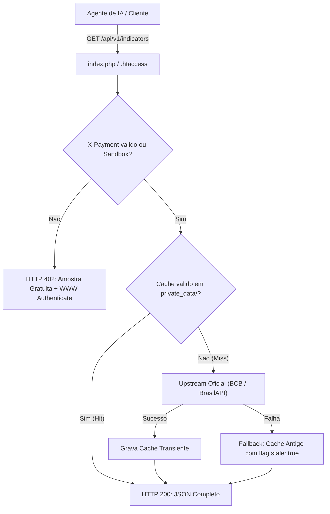

# Design Tecnico: Indicadores Economicos e Feriados Nacionais e Bancarios

## 1. Arquitetura e Fluxo de Dados

O Grid402 mantem estrita aderencia a sua arquitetura **Zero-DB e Stateless**. Toda chamada e processada em memoria e apoiada por arquivos JSON transientes em `public_html/private_data/` para garantir tolerancia a falhas caso as fontes governamentais fiquem temporariamente indisponiveis.



---

## 2. Contratos de API

### 2.1 `/api/v1/indicators`
- **Metodo:** `GET`
- **Headers Aceitos:** `X-Payment` (hash na Base ou `demo`)
- **Resposta HTTP 402 (Amostra Gratuita):**
```json
{
  "error": "PaymentRequired",
  "status": 402,
  "message": "Micropagamento de 0.0005 USDC requerido para liberar indicadores economicos completos.",
  "teaser": {
    "selic_target": 11.25,
    "reference_date": "2026-11-06",
    "locked_fields": ["selic_daily", "cdi_annual", "cdi_daily", "ipca_12m", "ipca_monthly"]
  },
  "price": "0.0005",
  "token": "USDC",
  "network": "Base",
  "receiver": "0xa31c31069c43ac1c0075a93c325b0dcd7744356c"
}
```
- **Resposta HTTP 200 (Completa):**
```json
{
  "status": "success",
  "service": "indicators",
  "timestamp": "2026-11-08T11:00:00Z",
  "indicators": {
    "selic_target": 11.25,
    "selic_daily": 11.15,
    "cdi_annual": 11.15,
    "cdi_daily": 0.0418,
    "ipca_12m": 3.98,
    "ipca_monthly": 0.42,
    "reference_date": "2026-11-06",
    "ipca_reference_month": "2026-10"
  },
  "source": "Banco Central do Brasil / IBGE",
  "cached": true
}
```

### 2.2 `/api/v1/holidays`
- **Metodo:** `GET`
- **Parametros:** `year` (opcional, inteiro, default: ano corrente)
- **Resposta HTTP 402 (Amostra Gratuita):**
```json
{
  "error": "PaymentRequired",
  "status": 402,
  "message": "Micropagamento de 0.0005 USDC requerido para liberar o calendario anual completo.",
  "teaser": {
    "next_holiday": {
      "date": "2026-11-15",
      "name": "Proclamacao da Republica",
      "type": "national",
      "day_of_week": "Domingo",
      "is_banking_holiday": true
    },
    "total_holidays_in_year": 12,
    "locked_fields": ["full_year_schedule", "banking_days_count"]
  },
  "price": "0.0005",
  "token": "USDC",
  "network": "Base",
  "receiver": "0xa31c31069c43ac1c0075a93c325b0dcd7744356c"
}
```
- **Resposta HTTP 200 (Completa):**
```json
{
  "status": "success",
  "service": "holidays",
  "year": 2026,
  "total_holidays": 12,
  "holidays": [
    {
      "date": "2026-01-01",
      "name": "Confraternizacao Universal",
      "type": "national",
      "day_of_week": "Quinta-feira",
      "is_banking_holiday": true
    },
    {
      "date": "2026-02-16",
      "name": "Carnaval (Segunda-feira)",
      "type": "banking",
      "day_of_week": "Segunda-feira",
      "is_banking_holiday": true
    }
  ],
  "source": "Calendario Nacional / ANBIMA / Febraban",
  "cached": true
}
```

---

## 3. Algoritmo Matematico de Feriados Moveis

Para garantir que o servico de feriados funcione com resiliencia total mesmo se upstream externo falhar, o servico implementa o calculo canonico da data da Pascoa baseado no Algoritmo de Meeus / Gauss:
- **Pascoa:** Calculada deterministicamente a partir do ano.
- **Carnaval:** Pascoa menos 47 dias.
- **Sexta-Feira Santa (Paixao de Cristo):** Pascoa menos 2 dias.
- **Corpus Christi:** Pascoa mais 60 dias.

Feriados fixos nacionais:
- 01/01: Confraternizacao Universal
- 21/04: Tiradentes
- 01/05: Dia Mundial do Trabalho
- 07/09: Independencia do Brasil
- 12/10: Nossa Senhora Aparecida
- 02/11: Finados
- 15/11: Proclamacao da Republica
- 20/11: Dia Nacional de Zumbi e da Consciencia Negra (Lei nº 14.759/2023)
- 25/12: Natal
- Ultimo dia util do ano: Sem expediente bancario para atendimento ao publico (Resolucao CMN).

---

## 4. Trade-offs

1. **Calculo Local vs API Externa:** Adotamos o algoritmo local com enriquecimento via BrasilAPI/ANBIMA quando disponivel. Vantagem: zero quebra de servico caso a API do governo fique instavel.
2. **Cache de 1 hora para Indicadores:** A Selic e o CDI sao definidos em reunioes do Copom ou no fechamento do dia. Um TTL de 1 hora e ideal para equilibrar frescor e performance sub-80ms.

