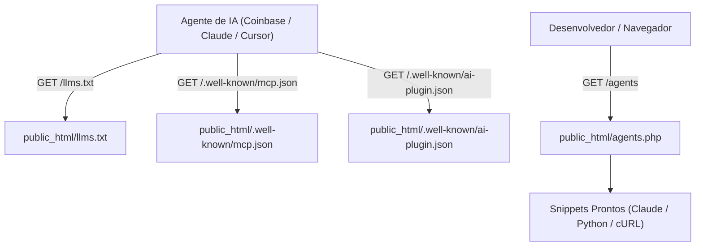

# Design Tecnico: Descoberta Autonoma para Agentes e Marketplaces

## Arquitetura de Descoberta Zero-DB
Todos os arquivos de descoberta (`llms.txt`, `llms-full.txt`, `mcp.json`, `ai-plugin.json`) sao mantidos como arquivos estaticos ou scripts leves em PHP nativo no diretorio publico `public_html/`.

Nenhuma consulta a banco de dados relacional e realizada, mantendo o principio de latencia minima (< 20 ms) e confiabilidade operacional sob alta frequencia de chamadas de robos e scrapers.

## Especificacao dos Manifestos

### 1. `llms.txt` e `llms-full.txt` (llmstxt.org)
- Localizacao: `public_html/llms.txt` e `public_html/llms-full.txt`
- Content-Type: `text/plain; charset=utf-8`
- Estrutura:
  - Titulo e descricao em Markdown.
  - Endpoints essenciais com metadados de precos em USDC na rede Base.
  - Instrucoes x402 (HTTP 402, envio de `X-Payment` tx hash).
  - Especificacao do oraculo criptografico com assinatura secp256k1 em `_oracle_proof`.
  - Links de referencia para schemas completos e OpenAPI.

### 2. `/.well-known/mcp.json`
- Localizacao: `public_html/.well-known/mcp.json`
- Content-Type: `application/json; charset=utf-8`
- Estrutura:
  - Formato padrao Model Context Protocol (MCP).
  - Declaracao formal das ferramentas (`grid402_summary`, `grid402_cnpj`, `grid402_cep`, `grid402_selic`, `grid402_cdi`, `grid402_ptax`, `grid402_holidays`, `grid402_workdays`, `grid402_verify`).
  - Argumentos, tipos de dados, descricoes e precos por chamada.

### 3. `/.well-known/ai-plugin.json`
- Localizacao: `public_html/.well-known/ai-plugin.json`
- Content-Type: `application/json; charset=utf-8`
- Estrutura:
  - Schema de manifesto de IA (schema_version v1).
  - URLs de documentacao, openapi.json, politicas de uso e logotipo.

### 4. Interface Web `/agents` (`agents.php`)
- Rota: `/agents` (reescrita via `.htaccess`)
- Estilo: Dark terminal theme em CSS nativo (alinhado com `index.php` e `admin.php`).
- Componentes:
  - Hero com proposta de valor e status dos servicos em tempo real.
  - Bloco Claude Desktop MCP com configuracao JSON e botao interativo de copia.
  - Bloco Python com codigo funcional utilizando a biblioteca `requests` e liquidacao x402.
  - Tabela interativa de endpoints, precos e comandos cURL de teste.
  - Botoes de acao para baixar `llms.txt` e inspecionar schemas OpenAPI.

## Seguranca e Politica de Cabecalhos
- Cabecalhos HTTP para `.json` e `.txt`:
  - `Access-Control-Allow-Origin: *`
  - `Access-Control-Allow-Methods: GET, OPTIONS`
  - `Access-Control-Allow-Headers: Content-Type, Authorization, X-Payment`
- Pre-flight OPTIONS respondido imediatamente com HTTP 204.

