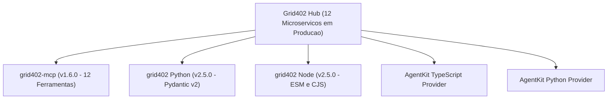

# Design Tecnico: Sincronizacao de SDKs e Coinbase AgentKit (v2.5.0)

## Arquitetura de Sincronizacao de Paridade
O ecossistema cliente do Grid402 foi desenhado para suportar tanto programacao tradicional (Python e Node.js) quanto integracoes agenticas (Model Context Protocol e Coinbase AgentKit).

## 1. Ferramenta `grid402_verify` no Servidor MCP (`mcp/`)
- Adicionada a lista de ferramentas em `mcp/tools.mjs`.
- Parametros de entrada:
  - `payload`: String JSON ou objeto contendo a resposta original da API com `_oracle_proof`.
- Endpoint de destino: `/api/v1/verify` (chamada gratuita via POST ou GET).
- Versao atualizada para `1.6.0` em `mcp/package.json`.

## 2. Action Providers do Coinbase AgentKit (`integrations/agentkit/`)
- Arquivos: `grid402_action_provider.ts` e `grid402_action_provider.py`.
- URL padrao de producao: `https://orangered-jackal-900744.hostingersite.com`.
- Novas acoes mapeadas:
  1. `queryIndicators` / `query_indicators`: Taxas Selic, CDI e IPCA.
  2. `queryHolidays` / `query_holidays`: Feriados bancarios e nacionais por ano.
  3. `queryWorkdays` / `query_workdays`: Contagem de dias uteis ANBIMA entre datas.
  4. `verifyProof` / `verify_proof`: Validacao criptografica da prova `_oracle_proof`.
- Tratamento nativo de auto-liquidacao de micropagamentos em USDC na rede Base.

## 3. Python SDK (`python/`)
- Atualizacao de versao em `python/pyproject.toml` para `2.5.0`.
- Atualizacao de `__version__ = "2.5.0"` em `python/grid402/__init__.py`.
- Geracao de artefatos de distribuicao `wheel` (`.whl`) e `source distribution` (`.tar.gz`) no diretorio `python/dist/`.

