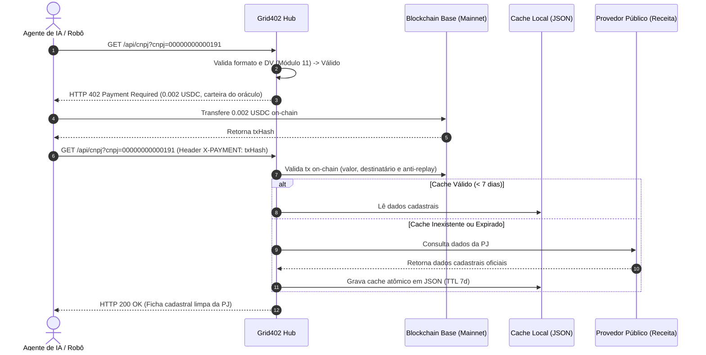

# PRD: API de Consulta Cadastral de CNPJ (Pessoa Jurídica)

**Status:** Em revisão  
**Data:** 2026-11-07  
**Autor:** thiago + Agente  

---

## 1. Contexto e Problema

Agentes de inteligência artificial autônomos (em ecossistemas B2B como compras, contas a pagar, conciliação fiscal, due diligence e CRM) operam 24/7 e precisam verificar a regularidade de fornecedores e clientes através de dados cadastrais de Pessoa Jurídica no Brasil (CNPJ). 

Atualmente, APIs de bureaus tradicionais de crédito exigem cadastros burocráticos, planos mensais caros, limites artificiais de requisições e cartões de crédito corporativos, criando um bloqueio intransponível para agentes de IA autônomos que operam com carteiras on-chain e necessitam de acesso máquina-a-máquina (M2M) sem atrito.

O **Grid402** já disponibiliza utilitários de rede e dados de mercado a $0.0005 USDC. A adição da **Consulta de CNPJ** introduz a primeira API corporativa de alto valor, cobrando **$0.002 USDC** por consulta via micropagamento HTTP 402 na rede Base, multiplicando a monetização e posicionando o hub como referência para agentes corporativos no Brasil.

---

## 2. Objetivos

- Disponibilizar o endpoint `GET /api/cnpj?cnpj={cnpj}` com resposta JSON padronizada de dados cadastrais de Pessoa Jurídica em menos de 100ms para consultas em cache.
- Monetizar cada consulta via protocolo HTTP 402 cobrando **$0.002 USDC** (4x o valor dos utilitários básicos) na rede Base Mainnet.
- Garantir **Risco Zero sob LGPD** para o operador pessoa física, limitando a resposta estritamente a informações cadastrais públicas da Pessoa Jurídica (descartando QSA com dados de sócios pessoas físicas).
- Proteger o robô pagador contra gastos desnecessários: validar os dígitos verificadores (DV) do CNPJ antes de emitir o desafio 402. Se o CNPJ for matematicamente inválido, retornar HTTP 400 gratuito imediatamente.
- Expandir o ecossistema integrando a nova ferramenta `grid402_cnpj` ao servidor MCP oficial (`grid402-mcp`), aos SDKs (Node.js e Python), ao console do portal público e ao painel administrativo.

---

## 3. Não Objetivos (Fora do Escopo)

- Não consultar nem retornar Quadro de Sócios e Administradores (QSA com nomes e CPFs de pessoas físicas), preservando estrita conformidade e Risco Zero sob LGPD.
- Não consultar certidões negativas de débito (CND), protestos, dados de dívida ativa ou balanços fiscais sigilosos.
- Não utilizar banco de dados relacional (MySQL/PostgreSQL), mantendo a arquitetura Zero-DB de arquivos planos JSON com escrita atômica e concorrência via `flock`.
- Não aceitar outras moedas além de USDC na rede Base Mainnet para a liquidação de pagamentos.

---

## 4. Público-Alvo e Personas

- **Agente Autônomo B2B:** Robô de pagamentos ou compras que precisa validar se a razão social, CNAE e situação cadastral do fornecedor estão ATIVAS antes de liquidar uma nota fiscal ou emitir uma ordem de compra.
- **Desenvolvedor de IA / Frameworks (CrewAI, LangChain, ElizaOS):** Desenvolvedor integrando oráculos de dados corporativos brasileiros em agentes autônomos sem precisar assinar contratos com bureaus de crédito.
- **Usuário Humano no Portal:** Desenvolvedor ou operador testando interativamente no portal web do Grid402.

---

## 5. Histórias de Usuário

- **US01:** Como agente autônomo, quero consultar os dados cadastrais de um CNPJ informando apenas o número para validar a situação cadastral de uma empresa antes de realizar negócios.
- **US02:** Como agente de IA, quero pagar exatamente $0.002 USDC na Base Mainnet por consulta via protocolo x402 sem precisar de assinatura mensal, chave de API prévia ou cadastro humano.
- **US03:** Como cliente do oráculo, quero que o Grid402 rejeite CNPJs matematicamente falsos ou inválidos com HTTP 400 sem me cobrar nada, garantindo integridade e confiança.
- **US04:** Como desenvolvedor usando Claude Desktop ou Cursor com o MCP `grid402-mcp`, quero chamar a ferramenta `grid402_cnpj` e receber a ficha cadastral formatada em JSON estruturado.
- **US05:** Como operador do Grid402, quero visualizar no painel administrativo (`admin.php`) o volume de chamadas, a receita gerada a $0.002 USDC e o status do cache do micro-serviço de CNPJ.

---

## 6. Requisitos Funcionais

| ID | Requisito | Prioridade |
|---|---|---|
| **RF01** | O endpoint `GET /api/cnpj` deve aceitar o parâmetro `cnpj` com ou sem máscara (`14` dígitos numéricos). | Must |
| **RF02** | O sistema deve validar matematicamente os dígitos verificadores (DV) do CNPJ via algoritmo módulo 11. Se o formato ou DV forem inválidos, deve retornar HTTP 400 Bad Request imediatamente sem emitir cobrança 402. | Must |
| **RF03** | O endpoint deve emitir HTTP 402 Payment Required com instrução de pagamento de **0.002 USDC** na rede Base Mainnet quando a requisição não apresentar cabeçalho `X-PAYMENT` válido. | Must |
| **RF04** | Quando fornecido `X-PAYMENT: <txHash>`, o sistema deve verificar a transação on-chain na Base (valor >= 0.002 USDC, destinatário = carteira do oráculo, sem replay via lock atômico) e retornar HTTP 200 com os dados cadastrais da PJ. | Must |
| **RF05** | O payload de resposta normalizado deve conter: `cnpj`, `razao_social`, `nome_fantasia`, `situacao_cadastral`, `data_situacao`, `data_abertura`, `cnae_fiscal`, `cnae_fiscal_descricao`, `cnaes_secundarios`, `natureza_juridica`, `endereco` (logradouro, numero, bairro, municipio, uf, cep), `capital_social` e metadados de cache. | Must |
| **RF06** | O sistema deve consultar provedores públicos abertos resilientes e salvar o resultado em cache JSON local atômico com TTL de 7 dias na pasta persistente. | Must |
| **RF07** | O servidor MCP oficial (`grid402-mcp`) deve ser atualizado com a ferramenta `grid402_cnpj` com suporte à liquidação automática de 0.002 USDC. | Must |
| **RF08** | Os SDKs oficiais (Node.js e Python) devem implementar o método `getCnpj(cnpj)`. | Must |
| **RF09** | O portal web (`index.php`) deve exibir o novo card de CNPJ no catálogo e incluir aba interativa no console de testes. | Must |
| **RF10** | O painel administrativo (`admin.php`) deve computar volume e faturamento com a tarifa de $0.002 USDC para o serviço `cnpj`. | Must |

---

## 7. Requisitos Não Funcionais

- **RNF01 (Performance):** Respostas em cache local devem ser entregues em menos de 100ms.
- **RNF02 (Arquitetura Zero-DB):** Cache e telemetria devem ser persistidos em arquivos planos JSON com escrita atômica via `grid402_atomic_write` e concorrência via `flock` no diretório persistente configurado.
- **RNF03 (Segurança Jurídica e LGPD):** Restrição absoluta a dados de domínio público da Pessoa Jurídica; nenhum dado pessoal de sócio PF é coletado, persistido ou transmitido.
- **RNF04 (Resiliência):** Se o upstream primário estiver indisponível, o sistema deve tentar o upstream secundário automaticamente antes de emitir erro.
- **RNF05 (Compatibilidade):** 100% compatível com PHP 8.x no ambiente de hospedagem Hostinger.
- **RNF06 (Padronização Textual):** Preservar a regra de ausência de e comercial em documentações e payloads (substituindo sempre por e).

---

## 8. Fluxos e UX

### Fluxo Principal (Agente com Pagamento x402):

### Fluxo Alternativo 1 (CNPJ Inválido - Gratuito):
1. O cliente envia `GET /api/cnpj?cnpj=11111111111111`.
2. O Grid402 valida o algoritmo módulo 11 e detecta dígitos verificadores inválidos.
3. O Grid402 retorna imediatamente `HTTP 400 Bad Request` com `{ "error": "CNPJ matematicamente inválido" }`.
4. O cliente não é cobrado e não há desafio 402.

### Fluxo Alternativo 2 (CNPJ Inexistente na Base da Receita):
1. O cliente envia CNPJ válido, realiza o pagamento de 0.002 USDC.
2. O upstream público retorna que o CNPJ não existe no cadastro federal.
3. O Grid402 retorna `HTTP 404 Not Found` informando que a empresa não foi localizada.

---

## 9. Métricas de Sucesso

- 100% de precisão na validação de dígitos verificadores de CNPJs no endpoint.
- Tempo de resposta para consultas em cache local inferior a 100ms.
- 0 dados pessoais identificáveis (PII) de pessoas físicas no payload.
- Faturamento de $0.002 USDC por consulta liquidada registrado com precisão no painel de administração.
- SDKs e Servidor MCP executando a consulta com sucesso em testes automatizados.

---

## 10. Riscos, Dependências e Premissas

- **Dependência de Upstream:** A primeira consulta a um CNPJ novo depende da disponibilidade do upstream público de dados abertos. Mitigado por timeout defensivo (5s), múltiplos provedores de fallback e cache prolongado de 7 dias.
- **Volatilidade de Rate Limit:** Upstreams públicos podem aplicar rate limit se houver picos. O cache local de 7 dias minimiza drasticamente as chamadas externas repetidas.

---

## 11. Questões em Aberto

- [x] Definição de escopo LGPD: Aprovado sem QSA.
- [x] Preço por consulta: Aprovado em $0.002 USDC.
- [x] Estratégia de cache: Aprovado cache local JSON com TTL de 7 dias.
