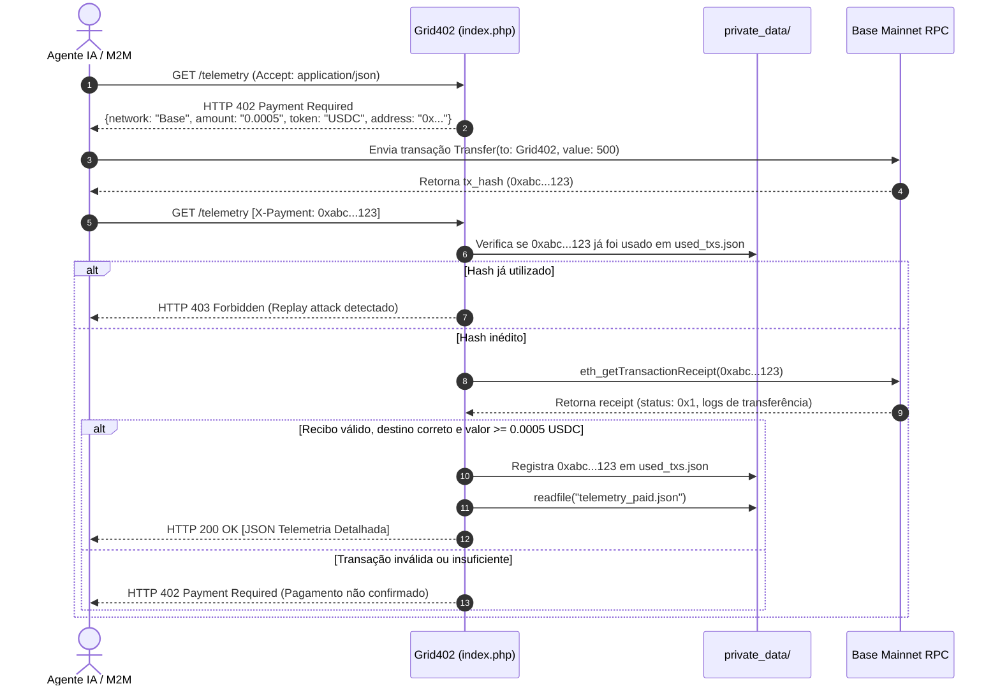

# PRD: Grid402 - Oráculo M2M de Telemetria e Status de Serviços Críticos (Protocolo x402)

**Status:** Em revisão  
**Data:** 2026-11-06  
**Autor:** Thiago + Agente Antigravity  

---

## 1. Contexto e problema
No ecossistema brasileiro de tecnologia e finanças, agentes autônomos de IA e sistemas Machine-to-Machine (M2M) processam volumes massivos de dados sensíveis e transações financeiras (como emissão de notas fiscais em lote via SEFAZ, liquidação de PIX e faturamento em gateways). Quando um desses serviços centrais sofre instabilidade, lentidão ou downtime não anunciado, as chamadas automatizadas falham em cascata, gerando filas travadas, cancelamentos indevidos e prejuízos operacionais.

Atualmente, não existe um oráculo leve, padronizado para IA e monetizado sob demanda capaz de responder em poucos milissegundos o estado real de saúde dessas APIs sem exigir assinaturas mensais pesadas, cadastros com cartão de crédito ou autenticação complexa. O protocolo HTTP x402 (`402 Payment Required`), liquidado em micropagamentos de criptoativos (USDC na Base), resolve esse gargalo permitindo que agentes paguem frações de centavos por consulta instantânea.

---

## 2. Objetivos
1. **Disponibilizar Telemetria em Tempo Real:** Monitorar continuamente 15 a 20 alvos críticos brasileiros (SEFAZ estaduais, PIX/Bancos, Gateways de Pagamento e Telecom/Cloud) com ciclos de sondagem entre 1 e 5 minutos.
2. **Latência de Entrega Extrema:** Responder consultas à API e chamadas de agentes em menos de 50ms para leitura de dados em cache direto do disco.
3. **Monetização M2M Nativa:** Implementar o fluxo HTTP x402 cobrando US$ 0.0005 por consulta detalhada, pago em USDC na rede Base.
4. **Infraestrutura Zero-Database e Custo Mínimo:** Operar com máxima eficiência em servidor compartilhado Hostinger (LiteSpeed + PHP 8.1+), sem banco de dados relacional ou SQLite, usando JSONs estáticos e validação on-chain direta.
5. **Acessibilidade para IA e Humanos:** Expor manifesto `llms.txt` para descoberta por bots e landing page dark-mode ultraleve para desenvolvedores humanos.

---

## 3. Não objetivos (fora do escopo da v1)
* **Persistência em SQL:** Não haverá suporte a MySQL, PostgreSQL ou SQLite na v1 para eliminar limites de concorrência e overhead de conexões.
* **Painel Administrativo com Login:** O sistema opera de forma autônoma e descentralizada, sem tela de login ou gerenciamento de usuários.
* **Assinaturas Recorrentes (SaaS Tradicional):** O modelo é estritamente pay-per-request via x402.
* **Histórico de Longo Prazo (> 24 horas):** O foco é a tomada de decisão em tempo de execução (últimas coletas e métricas imediatas); séries históricas analíticas de semanas/meses ficam para versões futuras.

---

## 4. Público-alvo e personas
* **Persona 1: Desenvolvedor de Agentes Autônomos de IA**
  * *Necessidade:* Precisa que o agente consulte programaticamente via cURL ou SDK se a SEFAZ-SP ou o Gateway de pagamento está operante antes de autorizar o envio de um lote de 1.000 transações.
  * *Dor:* Não quer criar conta nem cadastrar cartão; quer que a própria carteira do agente pague meio milésimo de dólar por requisição.
* **Persona 2: Engenheiro de Integração / Backend M2M**
  * *Necessidade:* Circuit breaker inteligente para balancear requisições entre gateways alternativos quando a latência de um provedor exceder 1.500ms.
* **Persona 3: Desenvolvedor / Arquiteto de Software**
  * *Necessidade:* Acessar o site pelo navegador para auditar visualmente a confiabilidade do serviço, ler a documentação do protocolo x402 e conferir snippets de integração.

---

## 5. Histórias de usuário
* **US01:** Como agente autônomo, quero consultar o endpoint `/` recebendo status consolidado gratuito, para saber rapidamente se o ecossistema está saudável.
* **US02:** Como agente autônomo, quero solicitar a telemetria detalhada de um serviço e receber resposta HTTP 402 com os parâmetros de pagamento (rede Base, contrato USDC, valor e carteira recebedora), para poder liquidar a transação on-chain.
* **US03:** Como agente autônomo, quero reenviar a requisição com o cabeçalho `X-Payment: <tx_hash>` e receber imediatamente o payload completo com latências exatas e diagnósticos técnicos.
* **US04:** Como engenheiro de software, quero acessar `https://www.grid402.com.br` no navegador e ver um dashboard dark-mode limpo com o status dos serviços e exemplos de integração.
* **US05:** Como sistema de agendamento (Cron), quero executar o coletor paralelamente via CLI ou URL autenticada por token secreto, para atualizar os dados em menos de 4 segundos sem estourar limites do servidor.

---

## 6. Requisitos funcionais

| ID | Requisito | Prioridade |
|---|---|---|
| **RF01** | O `collector.php` deve sondar em paralelo, via `curl_multi_init`, um catálogo padrão de 15 a 20 alvos (SEFAZ-SP, RS, MG, SVRS, SVAN, Mercado Pago, Asaas, Stripe, PagBank, BACEN/PIX, Bancos e CDNs). | Must |
| **RF02** | O coletor deve consolidar e gravar atomicamente em `private_data/summary_free.json` o resumo público (status booleano UP/DEGRADED/DOWN e latência média por categoria). | Must |
| **RF03** | O coletor deve gravar em `private_data/telemetry_paid.json` o payload completo com latência individual em ms, status code, headers de diagnóstico e score de estabilidade. | Must |
| **RF04** | O `collector.php` deve suportar disparo via CLI (`php collector.php`) e via HTTP com token de autenticação (`?token=CRON_SECRET` ou `Authorization: Bearer <token>`), rejeitando acessos não autorizados com HTTP 403. | Must |
| **RF05** | O `index.php` deve identificar o cabeçalho `Accept` da requisição e servir uma Landing Page HTML/CSS dark-mode responsiva se for navegador humano (`text/html`), ou dados de máquina se for `application/json` ou cliente automatizado. | Must |
| **RF06** | Ao receber solicitação do payload detalhado (`?detail=true` ou `/telemetry`) sem cabeçalho `X-Payment`, o `index.php` deve responder com `HTTP 402 Payment Required`, cabeçalho `WWW-Authenticate: x402` e body JSON com instruções de pagamento (rede Base, carteira, contrato USDC e valor 0.0005 USDC). | Must |
| **RF07** | Ao receber `X-Payment: <tx_hash>`, o `index.php` deve validar on-chain via chamada JSON-RPC da Base (`eth_getTransactionReceipt`) se a transação é válida, chamou o contrato USDC oficial, transferiu >= 0.0005 USDC para a carteira configurada e foi confirmada. | Must |
| **RF08** | O `index.php` deve registrar os hashes de transações já liquidados em `private_data/used_txs.json` com timestamp, bloqueando replay attacks (tentativas de reuso do mesmo hash). | Must |
| **RF09** | Se o pagamento for validado com sucesso, o `index.php` deve responder com `HTTP 200` e enviar o payload pago via leitura direta de disco (`readfile()`). | Must |
| **RF10** | O sistema deve disponibilizar o manifesto `llms.txt` na raiz pública contendo a descrição completa dos serviços, estrutura de dados e especificações da API para crawlers e LLMs. | Must |
| **RF11** | O diretório `private_data/` deve possuir proteção estrita em `.htaccess` (`Deny from all`) impedindo qualquer acesso HTTP direto aos arquivos JSON e de estado. | Must |
| **RF12** | As configurações sensíveis (endereço da carteira Base, RPC endpoint e token do cron) devem ser lidas a partir de arquivo `.env` fora do webroot ou protegido. | Must |

---

## 7. Requisitos não funcionais
* **Performance do Coletor:** O tempo total de execução do `collector.php` deve ser estritamente inferior a 4 segundos, utilizando timeout por socket de no máximo 3.0 segundos.
* **Performance da API:** A entrega do JSON gratuito e do JSON pago (após validação) deve levar menos de 50ms de processamento no servidor Hostinger LiteSpeed.
* **Segurança e Privacidade:** Nenhum token, chave privada de carteira ou segredo deve constar no código fonte rastreado no repositório. O `.env` deve ser mantido no `.gitignore`.
* **Disponibilidade e Resiliência:** Caso um ou mais endpoints externos monitorados estejam indisponíveis ou demorem a responder, o coletor não deve travar; a falha deve ser capturada individualmente e classificada como `DOWN` ou `TIMEOUT`.
* **Compatibilidade:** Código PHP compatível estritamente com PHP 8.1, 8.2 e 8.3 sem extensões exóticas (utilizando apenas extensões padrão: `curl`, `json`, `filter`).

---

## 8. Fluxos e UX

### 8.1. Fluxo do Micropagamento x402 (M2M)

### 8.2. Fluxo da Interface Web Humana
* Usuário acessa `https://www.grid402.com.br` no navegador (envia `Accept: text/html`).
* O `index.php` detecta o cabeçalho e renderiza a Landing Page dark-mode.
* Exibe:
  * Cartões de status em tempo real com indicador visual (Verde: Estável, Amarelo: Instável, Vermelho: Offline) alimentados pelo `summary_free.json`.
  * Latências médias por setor (SEFAZ, Pagamentos, Bancos).
  * Seção interativa com as instruções do protocolo x402 e snippets de código (Python, cURL e Node.js).
  * Link direto para `llms.txt`.

---

## 9. Métricas de sucesso
* **Taxa de Sucesso da Coleta:** 100% das execuções do cron finalizadas em menos de 4 segundos sem estourar limites de memória ou CPU da Hostinger.
* **Integridade do x402:** 0% de aceitação de transações falsificadas ou reaproveitadas (zero tolerância a replay attacks).
* **Tempo de Resposta P95:** < 50ms para chamadas à API da camada gratuita e < 250ms para chamadas pagas (incluindo o roundtrip de validação no RPC da Base).

---

## 10. Riscos, dependências e premissas
* **Risco de Latência do RPC da Base:** Se o RPC público da Base estiver lento, a validação do `X-Payment` pode demorar.
  * *Mitigação:* Configurar timeout de 1.5s na chamada cURL ao RPC e permitir URLs alternativas de fallback no `.env`.
* **Premissa de Limpeza de Hashes:** O arquivo `used_txs.json` acumulará dados ao longo do tempo.
  * *Mitigação:* Implementar purga automática de hashes com mais de 7 dias durante a rotina do `collector.php` ou após cada validação.
* **Limitações do cURL Multi no Hostinger:** Bloqueio de portas de saída ou firewalls.
  * *Mitigação:* Todos os alvos operam nas portas padrão HTTPS (443) com User-Agent customizado amigável (`Grid402-Telemetry-Probe/1.0`).

---

## 11. Questões em aberto
* Nenhuma pendência no momento (todas as dúvidas e decisões essenciais foram sanadas na etapa de Grill-me).

